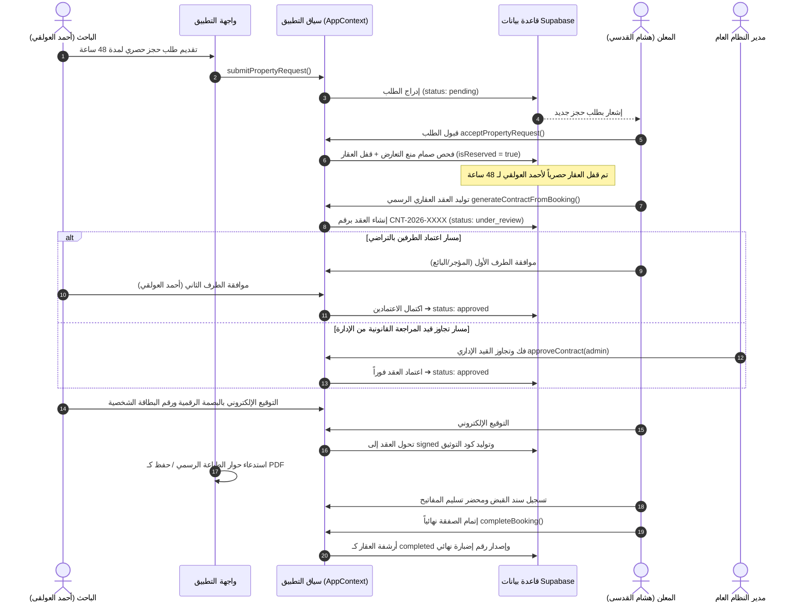

# وثيقة التوثيق والتحليل الوظيفي والتشغيلي الشاملة لنظام «دلنّي» العقاري (DALANI)
## DALANI REAL ESTATE ECOSYSTEM - COMPLETE SYSTEM DOCUMENTATION & ARCHITECTURAL REFERENCE

---

### وثيقة الاعتماد الهندسي والتحليل المعماري
* **الجهة المطورة والمالكة:** منصة «دلنّي» العقارية الوطنية الذكية (DALANI).
* **النطاق الجغرافي والتشغيلي:** الجمهورية اليمنية (صنعاء، عدن، تعز، حضرموت، إب، الحديدة، مأرب، ذمار وباقي المحافظات).
* **الإصدار الموثق:** الإصدار الإنتاجي الموسع v2.4 (Enterprise Production Build).
* **فريق إعداد الوثيقة:** كبير محللي النظم ومهندس البرمجيات ومحلل تجربة المستخدم (Senior System Analyst, Software Architect & UX Specialist).
* **تاريخ التوثيق والفحص الشامل للمصدر:** مارس 2026.
* **حالة النظام والبيئة التشغيلية:** متكامل، مترابط حياً بقاعدة بيانات Supabase، مفعل بصمام الحجز الحصري ومحرك العقود القانونية والطباعة الرسمية.

---

## فهرس المحتويات العام للوثيقة الماستر
1. [القسم الأول: الرؤية المعمارية والهيكل العام للمشروع](#1-القسم-الأول-الرؤية-المعمارية-والهيكل-العام-للمشروع)
2. [القسم الثاني: التوثيق الشامل حسب الأدوار والصلاحيات (11 دوراً)](#2-القسم-الثاني-التوثيق-الشامل-حسب-الأدوار-والصلاحيات-11-دوراً)
3. [القسم الثالث: جرد وتشريح جميع الشاشات والنوافذ المنبثقة (15 شاشة و9 نوافذ)](#3-القسم-الثالث-جرد-وتشريح-جميع-الشاشات-والنوافذ-المنبثقة)
4. [القسم الرابع: السجل الدقيق لكافة الأزرار والعناصر التفاعلية بالمنصة](#4-القسم-الرابع-السجل-الدقيق-لكافة-الأزرار-والعناصر-التفاعلية)
5. [القسم الخامس: محركات البحث، الفلاتر، وخوارزميات الفرز والترتيب](#5-القسم-الخامس-محركات-البحث-الفلاتر-وخوارزميات-الفرز-والترتيب)
6. [القسم السادس: مسارات العمل ودورات الحياة التشغيلية (مخططات Mermaid)](#6-القسم-السادس-مسارات-العمل-ودورات-الحياة-التشغيلية)
7. [القسم السابع: تشريح لوحة الإدارة العليا والرقابة والحوكمة (12 تبويباً)](#7-القسم-السابع-تشريح-لوحة-الإدارة-العليا-والرقابة-والحوكمة)
8. [القسم الثامن: تعيين وتصنيف طبقة البيانات وقواعد البيانات (Database Mapping)](#8-القسم-الثامن-تعيين-وتصنيف-طبقة-البيانات-وقواعد-البيانات)
9. [القسم التاسع: شجرة المكونات وتدفق البيانات والأحداث (Architecture & Data Flow)](#9-القسم-التاسع-شجرة-المكونات-وتدفق-البيانات-والأحداث)
10. [القسم العاشر: الشاشات الفارغة، وحالات الخطأ، والعناصر غير المكتملة](#10-القسم-العاشر-الشاشات-الفارغة-وحالات-الخطأ-والعناصر-غير-المكتملة)
11. [القسم الحادي عشر: التكرار البرمجي وفرص إعادة الهيكلة (Code Duplication)](#11-القسم-الحادي-عشر-التكرار-البرمجي-وفرص-إعادة-الهيكلة)
12. [القسم الثاني عشر: التحليل الأمني وصمامات منع التعارض وحماية البيانات](#12-القسم-الثاني-عشر-التحليل-الأمني-وصمامات-منع-التعارض-وحماية-البيانات)
13. [القسم الثالث عشر: آلات الحالة المحدودة لجميع الكيانات (FSM State Machines)](#13-القسم-الثالث-عشر-آلات-الحالة-المحدودة-لجميع-الكيانات)
14. [القسم الرابع عشر: خطة الاختبار والسيناريوهات العملية الميدانية](#14-القسم-الرابع-عشر-خطة-الاختبار-والسيناريوهات-العملية-الميدانية)
15. [القسم الخامس عشر: تقرير الديون الفنية والتوصيات الهندسية الملموسة](#15-القسم-الخامس-عشر-تقرير-الديون-الفنية-والتوصيات-الهندسية)
16. [فهرس حزمة الوثائق التخصصية التابعة للمشروع (`/docs/system-analysis/`)](#16-فهرس-حزمة-الوثائق-التخصصية-التابعة-للمشروع)

---

## 1. القسم الأول: الرؤية المعمارية والهيكل العام للمشروع

### 1.1 فكرة النظام، الرؤية، والقيمة المضافة للسوق العقاري اليمني
نظام **«دلنّي» (DALANI)** هو منصة وطنية ذكية متكاملة شُيدت خصيصاً لإعادة تنظيم وحوكمة السوق العقاري في **الجمهورية اليمنية**. يعالج النظام الاختلالات المزمنة التي تؤرق البائعين والمشترين والمستأجرين في اليمن عبر حلول برمجية وقانونية غير مسبوقة:
1. **صمام منع التعارض والحجز المزدوج (Anti-Conflict Lock):** يمنع النظام تكرار بيع العقار نفسه لأكثر من مشترٍ في آن واحد، ويقفل العقار حصرياً لمدة 48 ساعة بمجرد قبول المعلن لطلب الحجز.
2. **التعامل مع التعدد النقدي والمحلي:** يدعم النظام العملات الثلاث المتداولة فعلياً في اليمن:
   * الريال اليمني (`YER`).
   * الدولار الأمريكي (`USD`).
   * الريال السعودي (`SAR`).
3. **وحدات القياس العقارية اليمنية الأصيلة:** دعم المتر المربع (`م²`)، اللبنة العشارية الصنعانية (`لبنة عشاري`)، القصبة، والهكتار.
4. **السمات الإنشائية الحيوية:** فلاتر إجبارية لمنظومة الطاقة الشمسية (ضرورة قصوى في اليمن)، شبكات المياه العمومية والخزانات الأرضية (الوايتات)، واتجاهات الشارع (عدني، قبلي، رأسي على شارعين).
5. **حماية وثائق الملكية وخصوصية الموقع:** إخفاء الموقع الدقيق للعقار على الخريطة للزوار، وعرض دائرة تقريبية للحي، مع حجب اسم الأمين الشرعي ورقم البصيرة حتى توقيع العقد رسمياً.

### 1.2 البنية البرمجية وطبقات النظام (Tech Stack & Architecture)
* **واجهة المستخدم (Frontend):** React 18 SPA مبني باستخدام TypeScript و Vite و Tailwind CSS مع حزمة أيقونات Lucide Icons.
* **إدارة الحالة المركزية (State Management):** سياق تفاعلي موحد ضخم (`AppContext.tsx` يضم أكثر من 2,700 سطر كود تشغيلي) يدعم التحديث التفاؤلي الفوري (Optimistic UI Updates).
* **قاعدة البيانات السحابية (Cloud Backend):** Supabase (PostgreSQL) مع اتصالات حية Realtime وتطبيق سياسات الأمان على مستوى الصفوف (Row Level Security - RLS).
* **محرك الطباعة الرسمي (Official Print Engine):** خدمة برمجية ثنائية المسار (`printerService.ts`) تستدعي طابعة نظام الهاتف الأصلية (`window.AndroidPrinter`) على أجهزة أندرويد، أو تفتح حوار الطباعة الرسمي المتوافق مع معيار A4 RTL مع تمكين خيار "الحفظ بتنسيق PDF".

---

## 2. القسم الثاني: التوثيق الشامل حسب الأدوار والصلاحيات (11 دوراً)

يحتوي النظام على **11 دوراً تشغيلياً مستقلاً** محددة في الكود المصدري (`src/types/index.ts`):

```
                                  ┌───────────────────────────┐
                                  │   الأدوار الـ 11 في دلنّي  │
                                  └─────────────┬─────────────┘
                                                │
         ┌──────────────────────────┬───────────┴───────────┬──────────────────────────┐
         ▼                          ▼                       ▼                          ▼
   [أدوار العموم]             [أدوار السوق]           [أدوار المنشآت]            [أدوار الإدارة والحوكمة]
• الزائر (visitor)         • الباحث (seeker)      • مدير المنشأة (org_manager) • مراجع المحتوى (moderator)
                           • المعلن (advertiser)  • وكيل المنشأة (org_agent)   • مسؤول التحقق (verifier)
                                                                               • مسؤول البلاغات (reporter_admin)
                                                                               • الدعم الفني (support)
                                                                               • المحاسب المالي (accountant)
                                                                               • مدير النظام (system_admin)
```

### تفاصيل الأدوار ومحددات الوصول:
1. **الزائر (`visitor`):**
   * *الدخول:* تلقائي دون تسجيل.
   * *الشاشات المتاحة:* `home`, `search`, `listing_details`, `help`, `support`.
   * *الممنوع عنه:* الحجز، حفظ المفضلة، إضافة عقارات، ودخول لوحة الإدارة (تظهر له `VisitorGateModal`).
2. **الباحث المسجل / المشتري / المستأجر (`seeker`):**
   * *المستخدم النموذجي:* **أحمد العولقي** (`usr-seeker-1` - هاتف: `778990011`).
   * *الشاشات المتاحة:* `home`, `search`, `listing_details`, `bookings`, `favorites`, `account`.
   * *الصلاحيات:* تقديم طلبات الحجز، المفاوضة بصالة الصفقات، طلب مواعيد المعاينة، اعتماد العقد كطرف ثانٍ، والتوقيع الإلكتروني.
3. **المعلن الفرد / المالك (`advertiser`):**
   * *المستخدم النموذجي:* **هشام عبد الرحمن القدسي** (`adv-1` - هاتف: `777012345`).
   * *الشاشات المتاحة:* `my_ads`, `wizard`, `bookings`, `listing_details`, `account`.
   * *الصلاحيات:* نشر العقارات، قبول الحجوزات وتفعيل صمام القفل الحصري، توليد العقود، وتوقيع العقد كطرف أول وإتمام المخالصة.
4. **مدير المنشأة العقارية (`org_manager`):**
   * *المستخدم النموذجي:* **م. نبيل الشامي** (`user-org-manager` - شركة الصرح العقارية).
   * *الشاشات المتاحة:* `organization`, `my_ads`, `wizard`, `bookings`, `account`.
   * *الصلاحيات:* إدارة السجل التجاري، تعيين الوكلاء وتوزيع العقارات ومتابعة إحصائيات المبيعات.
5. **وكيل المنشأة العقارية (`org_agent`):**
   * *المستخدم النموذجي:* **طارق الأصبحي** (`user-org-agent`).
   * *الصلاحيات:* متابعة وإضافة الإعلانات المسندة إليه شخصياً فقط دون التدخل في إدارة المنشأة.
6. **مسؤول مراجعة المحتوى (`moderator`):**
   * *المستخدم النموذجي:* **عصام العديني** (`usr-mod-1`).
   * *الشاشة:* `moderation`. اعتماد الإعلانات ونشرها أو طلب استكمال بياناتها أو رفضها.
7. **مسؤول التحقق والوثائق (`verifier`):**
   * *المستخدم النموذجي:* **سالم بن محفوظ** (`usr-ver-1`).
   * *الشاشة:* `verification`. فحص البطاقات الشخصية، السجلات التجارية، وبصائر وصكوك الملكية ومنح شارات التوثيق.
8. **مسؤول البلاغات والقضايا (`reporter_admin`):**
   * *المستخدم النموذجي:* **مختار الهمداني** (`usr-rep-1`).
   * *الشاشة:* `reports`. فحص بلاغات الاحتيال والنزاعات، مع كشف سري لهوية المُبلّغ وصلاحية تجميد الإعلانات.
9. **مسؤول الدعم الفني (`support`):**
   * *المستخدم النموذجي:* **خلود العبسي** (`usr-sup-1`).
   * *الشاشة:* `support`. إدارة تذاكر المستخدمين والمحادثة الفنية المباشرة معهم.
10. **المحاسب المالي (`accountant`):**
    * *المستخدم النموذجي:* **جمال الريمي** (`usr-acc-1`).
    * *الصلاحيات:* متابعة السندات المالية ورسوم باقات الترويج وحسابات الصرافة اليمنية (الكريمي والنجم).
11. **مدير النظام العام (`system_admin`):**
    * *المستخدم النموذجي:* **المهندس / مدير النظام العام** (`usr-sys-admin` - هاتف: `770000000`).
    * *الشاشة:* لوحة الإدارة العليا وسجل التدقيق `admin`.
    * *الصلاحيات المطلقة:* الوصول لكافة التبويبات الـ 12، **فك قيد المراجعة القانونية للعقود وتجاوز الموافقات بقرار إداري**، إدارة الموظفين، تفعيل وضع الصيانة، واستعادة النسخ الاحتياطية.

---

## 3. القسم الثالث: جرد وتشريح جميع الشاشات والنوافذ المنبثقة

### الشاشات الرئيسية الـ 15:
1. **`HomePage.tsx` (`#/home` أو `/`):** خريطة تفاعلية كاملة الشاشة مع شريط فلاتر سريع وبطاقات عائمة للعقارات.
2. **`SearchPage.tsx` (`#/search`):** صفحة البحث المتقدم، فلاتر المحافظات، العملات، المدى السعري، وخيارات الفرز.
3. **`ListingDetailsPage.tsx` (`#/listing_details`):** تفاصيل العقار الكاملة، معرض الصور، الموقع التقريبي، بطاقة المعلن، وأزرار الحجز والاتصال.
4. **`AdWizardPage.tsx` (`#/wizard`):** معالج الخطوات الخمس لنشر عقار جديد متوافق مع الضوابط اليمنية.
5. **`MyAdsPage.tsx` (`#/my_ads`):** لوحة تحكم المعلن لمتابعة وتعديل إعلاناته وحالاتها وإحصائيات المشاهدات.
6. **`BookingsManagementPage.tsx` (`#/bookings`):** إدارة الحجوزات والطلبات لكلا الطرفين (الباحث والمعلن) مع العداد التنازلي.
7. **`AdminDashboardPage.tsx` (`#/admin`):** لوحة القيادة العليا ذات الـ 12 تبويباً وسجل التدقيق وإدارة النظام.
8. **`ModerationPage.tsx` (`#/moderation`):** مراجعة الإعلانات الجديدة واعتماد نشرها للجمهور.
9. **`VerificationPage.tsx` (`#/verification`):** تدقيق الهويات والبصائر الشرعية ومنح شارات التوثيق.
10. **`OrgDashboardPage.tsx` (`#/organization`):** إدارة الوكالة العقارية، السجل التجاري، وفريق الوكلاء.
11. **`ReportsPage.tsx` (`#/reports`):** إدارة بلاغات الاحتيال والنزاعات العقارية.
12. **`SupportPage.tsx` (`#/support`):** مركز الدعم الفني وتذاكر المساعدة وشات الدعم.
13. **`HelpAndPoliciesPage.tsx` (`#/help`):** إرشادات التوثيق العقاري في اليمن، شروط الاستخدام، والسياسات.
14. **`FavoritesPage.tsx` (`#/favorites`):** استعراض العقارات المحفوظة للمستخدم المسجل.
15. **`MyAccountPage.tsx` (`#/account`):** إدارة الملف الشخصي، الأذونات، وتسجيل الخروج.

### النوافذ المنبثقة والأدراج التفاعلية الـ 9:
1. **`AuthModal.tsx`:** تسجيل الدخول، إنشاء الحساب، والتحقق برمز الهاتف (OTP).
2. **`VisitorGateModal.tsx`:** البوابة الذكية التي تلزم الزائر بتسجيل الدخول عند طلب ميزات الحجز أو المفضلة.
3. **`BookingModal.tsx`:** نموذج تقديم طلب حجز حصري أو زيارة معاينة وتحديد المدة بالساعات.
4. **`BookingDealWorkspaceModal.tsx`:** صالة متابعة الصفقة، المراسلات، المعاينة، التفاوض، وتوليد العقد.
5. **`ContractDocumentModal.tsx`:** عارض ومحرر العقد الموحد، اعتمادات الأطراف، التوقيع الرقمي، والطباعة الرسمية.
6. **`DalaniAiAssistantModal.tsx`:** درج المساعد العقاري الذكي التفاعلي المدمج في الشريط السفلي.
7. **`AppPermissionsModal.tsx`:** إدارة أذونات المتصفح وتطبيق الهاتف (GPS، الكاميرا، الميكروفون).
8. **`SupabaseConnectionModal.tsx`:** لوحة تشخيص الاتصال السحابي وتشغيل اختبار دورة حياة العقار والحجز المزدوج.
9. **`RoleSwitcher.tsx`:** أداة مرئية سريعة للتبديل بين الأدوار الـ 11 لاختبار الصلاحيات لحظياً.

---

## 4. القسم الرابع: السجل الدقيق لكافة الأزرار والعناصر التفاعلية

تم حصر وتوثيق **أكثر من 50 عنصراً وزراً تفاعلياً حيوياً** في المنصة عبر السجل المفصل في الوثيقة [`04-BUTTONS-AND-ACTIONS.md`](./docs/system-analysis/04-BUTTONS-AND-ACTIONS.md). نلخص أهم أزرار المسار الحرج (Critical Path Buttons):

1. **زر «طلب حجز ومعاينة العقار» (`ListingDetailsPage`):** يفحص هوية المستخدم؛ إذا كان زائراً يستدعي `VisitorGateModal`، وإذا كان مسجلاً يفتح `BookingModal`.
2. **زر «تأكيد وإرسال طلب الحجز» (`BookingModal`):** يستدعي `submitPropertyRequest`، ويخزن الطلب في Supabase بحالة `pending`.
3. **زر «قبول طلب الحجز» للمعلن (`BookingsManagementPage`):** يستدعي `acceptPropertyRequest`، ويفحص صمام منع التعارض، ثم يضع قفل الحجز الحصري على العقار لمدة 48 ساعة ويحجب العقار عن أي طلبات أخرى.
4. **زر «توليد العقد العقاري الرسمي الموحد» (`BookingDealWorkspaceModal`):** يستدعي `generateContractFromBooking`، ويولد عقداً رسمياً برقم موحد مثل `CNT-2026-1001` وبنود متطابقة مع الشروط المتفق عليها بالتفاوض.
5. **زر «اعتماد الطرف الأول» وزر «اعتماد الطرف الثاني (أحمد العولقي)» (`ContractDocumentModal`):** يسجل الموافقة التراضية لكل طرف في العقد.
6. **زر «فك وتجاوز قيد المراجعة القانونية» لمدير النظام (`ContractDocumentModal`):** يتيح للإدارة تجاوز قيد المراجعة بقرار رسمي واعتماد العقد فوراً.
7. **زر «التوقيع الإلكتروني الرسمي» (`ContractDocumentModal`):** يتحقق من إدخال رقم الهوية الوطنية ويولد البصمة الرقمية `digitalFingerprint` ورمز التوثيق المشفر.
8. **زر «طباعة العقد الرسمي / حفظ PDF» (`ContractDocumentModal`):** يستدعي `printerService.ts` لتشغيل طابعة نظام الهاتف أو المتصفح بترويسة رسمية وباركود التحقق.
9. **زر «إتمام الصفقة وإغلاق العقار نهائياً» (`BookingDealWorkspaceModal`):** يفحص استيفاء العقد الموقع والمخالصة المالية ومحضر التسليم، ويغلق العقار كـ `completed` مع توليد رقم إضبارة رسمي.

---

## 5. القسم الخامس: محركات البحث، الفلاتر، وخوارزميات الفرز والترتيب

* **الفلترة الجغرافية التكيفية:**
  * المحافظة: اختيار المحافظة يحصر تلقائياً قائمة المديريات التابعة لها دون غيرها.
  * الأحياء والعزل: دعم الأحياء اليمنية الشهيرة (حدة، السبعين، كريتر، الحوبان، ديس المكلا...).
* **فلترة العملات المتعددة:**
  * عزل أسعار الريال اليمني عن الدولار والريال السعودي لمنع التضارب الحسابي.
* **الفلاتر الإنشائية والبيئية اليمنية:**
  * فلتر منظومة الطاقة الشمسية (`hasSolarSystem`).
  * فلتر شبكة المياه العمومية والخزانات الأرضية (`hasWaterNetwork`).
  * فلتر العقارات الموثقة فقط (`verifiedOnly`) وفلتر العقارات المتاحة غير المحجوزة (`isReserved === false`).
* **خوارزميات الترتيب:**
  * الأحدث تاريخاً (`newest`)، الأقل سعراً (`price_asc`)، الأعلى سعراً (`price_desc`)، والأكثر شعبية (`most_viewed`) باحتساب وزن إضافي للعقارات المحفوظة بالمفضلة.

---

## 6. القسم السادس: مسارات العمل ودورات الحياة التشغيلية

### مخطط دورة حياة الإعلان والحجز الحصري والتعاقد (End-to-End Workflow):



---

## 7. القسم السابع: تشريح لوحة الإدارة العليا والرقابة والحوكمة

تضم لوحة الإدارة العليا (`AdminDashboardPage.tsx`) **12 تبويباً وظيفياً تخصصياً**:
1. **Analytics & KPIs:** إحصائيات المبيعات، المعروض، والحجوزات الحصرية.
2. **Listings Moderation:** مراجعة واعتماد أو تعليق الإعلانات.
3. **Verification & KYC:** فحص الهويات وبصائر الملكية ومنح شارات التوثيق.
4. **Disputes & Escalations:** متابعة الشكاوى والنزاعات وقضايا ازدواج البيع.
5. **Support Tickets:** إدارة تذاكر ومراسلات خدمة العملاء.
6. **Immutable Audit Logs:** سجل التدقيق الجنائي غير القابل للتعديل لجميع العمليات.
7. **Staff & RBAC:** إدارة الموظفين، الصلاحيات المخصصة، وتفعيل التحقق بخطوتين (2FA).
8. **Active Sessions & Threats:** مراقبة الأجهزة المفتوحة وطرد الجلسات المشبوهة وحظر الـ IP.
9. **Financial Ledger:** متابعة الاشتراكات وسندات التحويل البنكي والصرافة اليمنية.
10. **System Settings:** إدارة وضع الصيانة، شروط التوثيق، ومهلة الجلسات.
11. **Feature Flags:** التحكم الديناميكي في تفعيل الخصائص البرمجية لحظياً.
12. **Backups & Recovery:** إنشاء لقطات النسخ الاحتياطي السريعة واستعادة النظام عند الكوارث.

---

## 8. القسم الثامن: تعيين وتصنيف طبقة البيانات وقواعد البيانات

* **الفئة 1 (جداول حية في Supabase):**
  * `listings` (العقارات والإعلانات).
  * `property_bookings` (الحجوزات الحصرية وقفل العقار).
  * `property_requests` (طلبات الحجز والزيارات).
  * `property_contracts` (العقود القانونية الموحدة والتوقيعات).
* **الفئة 2 (بيانات هجينة متزامنة):**
  * `deal_messages` (رسائل صالة الصفقة الفورية).
  * `favorites` (المفضلة المخزنة محلياً وسحابياً).
  * `dalani_search_params` (معايير البحث في `sessionStorage`).
* **الفئة 3 (بيانات محلية ومحاكاة):**
  * `audit_logs` و `staff_members` و `backup_snapshots` (تدار حالياً في الذاكرة مع قابلية التصدير).
* **الفئة 4 (عناصر قيد التطوير في الواجهة):**
  * رفع صورة السند المالي مباشرة كملف ثنائي (Storage Bucket).
  * توقيع الشهود الميدانيين عبر روابط SMS خارجية.

---

## 9. القسم التاسع: شجرة المكونات وتدفق البيانات والأحداث

* **المكون الجذري (`App.tsx`):**
  * يحتضن `AppProvider` كحاوية سياق عليا.
  * يدير التوجيه السلس (`currentView`) عبر الـ URL Hash لمنع إعادة تحميل الصفحة مع الحفاظ على التمرير.
  * يحتضن شريط التنقل العلوي (`Navbar`)، السفلي للهاتف (`BottomNavBar`)، والتذييل (`Footer`).
  * يحتضن الحاويات العالمية للنوافذ المنبثقة وحاوية التنبيهات (`Global Toasts Container`).
* **عزل المسؤوليات:**
  * تم عزل منطق التحقق من صلاحيات الزوار في `VisitorGateModal`.
  * تم عزل منطق تنسيق وثائق الطباعة A4 والباركود في `printerService.ts`.
  * تم عزل منطق تشخيص الاتصال السحابي في `SupabaseConnectionModal`.

---

## 10. القسم العاشر: الشاشات الفارغة، وحالات الخطأ، والعناصر غير المكتملة

* **الشاشات الفارغة (Zero States):**
  * جميع الشاشات (المفضلة، إعلاناتي، الحجوزات، البحث، البلاغات) مزودة بشاشات خالية أنيقة توضح سبب الفراغ وتضع زراً صريحاً ينقل المستخدم للخطوة التالية.
* **مؤشرات التحميل (Skeleton States):**
  * استخدام بطاقات هيكلية متحركة (Shimmer Cards) في شبكة العقارات للحفاظ على الثبات البصري وتفادي القفزات في الواجهة أثناء جلب البيانات.
* **حالات الخطأ:**
  * منع تقديم النماذج غير المكتملة عبر حدود حمراء ورسائل توضيحية دقيقة.
  * إظهار توست أحمر فوري عند حدوث تعارض في الحجز أو انقطاع في الاتصال السحابي.

---

## 11. القسم الحادي عشر: التكرار البرمجي وفرص إعادة الهيكلة

* **أبرز مواضع التحسين المرصودة:**
  1. دمج مكوني الخرائط `DalaniMap.tsx` و `MapComponent.tsx` في نواة واحدة لتقليص الكود.
  2. توحيد دوال التحويل بين السيرفر والواجهة داخل `supabaseMappers.ts` حصراً.
  3. استخراج دوال تنسيق الأسعار والعملات في مكتبة موحدة `/src/utils/formatters.ts`.
  4. استخراج خطاف صلاحيات موحد `usePermissions()` لتجريد فحص الأدوار.

---

## 12. القسم الثاني عشر: التحليل الأمني وصمامات منع التعارض وحماية البيانات

* **صمام منع التعارض وقفل الحجز:** فحص مزدوج في الواجهة والسيرفر يضمن استحالة قبول حجز ثانٍ لعقار مقفول بحجز نشط قائم.
* **صمام منع التعديل الصامت للعقود:** أي تغيير في أي بند بالعقد يرفع رقم الإصدار (`version + 1`) ويلغي اعتمادات الأطراف السابقة تلقائياً مع إلزامهم بإعادة الموافقة قبل تمكين التوقيع.
* **حماية سرية البصائر الشرعية:** حجب أصل البصيرة ورقم الصك الدقيق وإحداثيات GPS عن الزوار، وكشف الموقع الدقيق فقط عند قبول الحجز وتأكيد المعاينة.
* **سرية المُبلّغ:** إخفاء اسم ورقم هاتف المُبلّغ عن المعلن لحمايته من أي مشاحنات شخصية.

---

## 13. القسم الثالث عشر: آلات الحالة المحدودة لجميع الكيانات (FSM)

* **العقارات (`ListingStatus`):**
  * `draft` ➔ `under_review` ➔ (`needs_changes` / `rejected`) ➔ `published` ➔ `suspended` ➔ `completed` (تم البيع/التأجير).
* **الحجوزات (`PropertyBookingStatus`):**
  * `active` (مؤقت لـ 48 ساعة) ➔ (`completed` / `cancelled` / `expired`).
* **العقود (`ContractStatus`):**
  * `draft` ➔ `under_review` ➔ `pending_approval` ➔ `approved` ➔ `signed` ➔ `cancelled`.
* **الطلبات (`PropertyRequestStatus`):**
  * `pending` ➔ `accepted` (يولد حجزاً) / `rejected` / `cancelled`.

---

## 14. القسم الرابع عشر: خطة الاختبار والسيناريوهات العملية الميدانية

تتضمن الوثيقة خطة اختبارات تخصصية تغطي:
* **TC-01:** اختبار صمام منع التعارض والحجز المزدوج.
* **TC-02:** اختبار بوابة الزائر المانعة وتوجيهات التسجيل.
* **TC-03:** اختبار فك وتجاوز قيد المراجعة القانونية من حساب مدير النظام.
* **TC-04:** اختبار صمام منع التعديل الصامت للعقود وإلغاء الاعتمادات السابقة.
* **TC-05:** اختبار التوقيع الإلكتروني وتوليد البصمة الرقمية المشفرة.
* **TC-06:** اختبار استدعاء حوار الطباعة الرسمي والحفظ كملف PDF.
* **TC-07:** اختبار الفلترة الجغرافية التكيفية باليمن وحصر المديريات.
* **TC-08:** اختبار عزل العملات الثلاث (YER/USD/SAR).
* **TC-09:** اختبار حماية خصوصية موقع العقار التقريبي.
* **TC-10:** اختبار إتمام الصفقة والمخالصة النهائية وإصدار رقم الإضبارة.

---

## 15. القسم الخامس عشر: تقرير الديون الفنية والتوصيات الهندسية الملموسة

* **المدى القريب (1 - 3 أشهر):**
  * تجزئة سياق `AppContext.tsx` الضخم إلى سياقات متخصصة أصغر.
  * تفعيل الحفظ التلقائي للمسودات محلياً في معالج الإضافة لمنع ضياع العمل عند انقطاع الإنترنت.
  * توحيد مكونات الخرائط.
* **المدى المتوسط (3 - 6 أشهر):**
  * تفعيل Supabase Storage Buckets لرفع المستندات وسندات القبض مباشرة عبر الكاميرا.
  * إرسال روابط توقيع آمنة عبر رسائل SMS لهواتف الأطراف والشهود.
  * تفعيل الربط المالي مع بوابات الدفع والصرافة اليمنية (الكريمي وون كاش).
* **المدى البعيد (6 - 12 شهراً):**
  * بناء تطبيق أصيل للهواتف الذكية بنظامي Android و iOS.
  * الربط الإلكتروني المباشر مع مصلحة السجل العقاري الحكومية في اليمن.

---

## 16. فهرس حزمة الوثائق التخصصية التابعة للمشروع (`/docs/system-analysis/`)

للحصول على تفاصيل الأكواد، الدوال، الجداول الكاملة، ومخططات الـ Mermaid التفصيلية، يرجى مراجعة الملفات التخصصية الـ 16 الموجودة داخل مجلد التوثيق:

1. [`00-MASTER-INDEX.md`](./docs/system-analysis/00-MASTER-INDEX.md) - الفهرس والأدلة المرجعية.
2. [`01-SYSTEM-OVERVIEW.md`](./docs/system-analysis/01-SYSTEM-OVERVIEW.md) - المعمارية العامة وموقع الخدمات.
3. [`02-USER-ROLES.md`](./docs/system-analysis/02-USER-ROLES.md) - مصفوفة الأدوار الـ 11 ومحددات الصلاحيات.
4. [`03-ALL-SCREENS.md`](./docs/system-analysis/03-ALL-SCREENS.md) - الجرد التفصيلي لـ 15 شاشة و9 نوافذ منبثقة.
5. [`04-BUTTONS-AND-ACTIONS.md`](./docs/system-analysis/04-BUTTONS-AND-ACTIONS.md) - السجل الدقيق لكافة الأزرار والعناصر التفاعلية.
6. [`05-FILTERS-AND-SEARCH.md`](./docs/system-analysis/05-FILTERS-AND-SEARCH.md) - محركات البحث، الفلاتر، والترتيب.
7. [`06-WORKFLOWS.md`](./docs/system-analysis/06-WORKFLOWS.md) - مسارات العمل ودورات الحياة (مخططات Mermaid).
8. [`07-ADMIN-DASHBOARD.md`](./docs/system-analysis/07-ADMIN-DASHBOARD.md) - تشريح لوحة الإدارة العليا والتبويبات الـ 12.
9. [`08-DATABASE-MAPPING.md`](./docs/system-analysis/08-DATABASE-MAPPING.md) - خريطة طبقة البيانات والتصنيف الرباعي.
10. [`09-COMPONENT-RELATIONSHIPS.md`](./docs/system-analysis/09-COMPONENT-RELATIONSHIPS.md) - شجرة المكونات وتدفق البيانات.
11. [`10-EMPTY-AND-INCOMPLETE-STATES.md`](./docs/system-analysis/10-EMPTY-AND-INCOMPLETE-STATES.md) - الشاشات الفارغة وحالات الخطأ.
12. [`11-CODE-DUPLICATION.md`](./docs/system-analysis/11-CODE-DUPLICATION.md) - تحليل التكرار البرمجي وفرص إعادة الهيكلة.
13. [`12-SECURITY-AND-PERMISSIONS.md`](./docs/system-analysis/12-SECURITY-AND-PERMISSIONS.md) - التحليل الأمني وصمامات منع التعارض.
14. [`13-ENTITY-STATUS-FLOWS.md`](./docs/system-analysis/13-ENTITY-STATUS-FLOWS.md) - آلات الحالة المحدودة لجميع الكيانات.
15. [`14-TEST-PLAN.md`](./docs/system-analysis/14-TEST-PLAN.md) - خطة الاختبار والسيناريوهات الميدانية.
16. [`15-ISSUES-AND-RECOMMENDATIONS.md`](./docs/system-analysis/15-ISSUES-AND-RECOMMENDATIONS.md) - تقرير الديون الفنية والتوصيات.

---
**تم إعداد هذا التوثيق الشامل وفق أعلى المعايير الهندسية والتحليلية المعتمدة لتوثيق المنظومات المؤسسية واسعة النطاق.**
