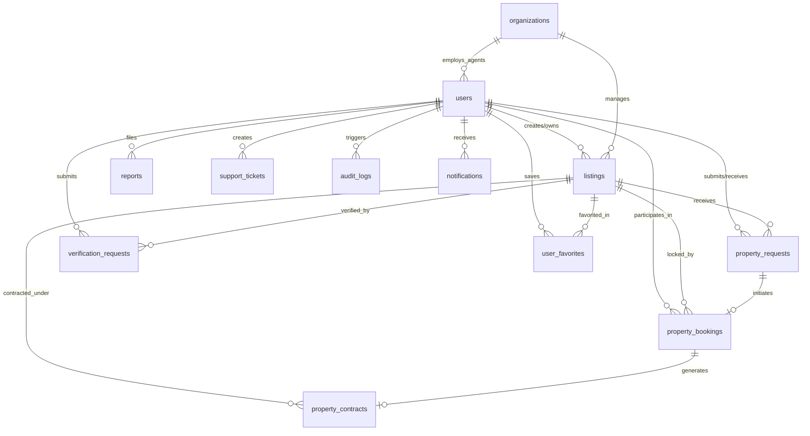

# الوثيقة المرجعية لمعمارية قاعدة بيانات منصة «دلنّي» العقارية اليمنية
## Dalani Platform Database Architecture & Technical Reference (Supabase / PostgreSQL)

---

## 1. نظرة عامة ومعمارية البيانات (Architecture Overview)

قاعدة بيانات **منصة «دلنّي»** مصممة لتكون المحرك السيادي الموثوق لجميع التعاملات العقارية في الجمهورية اليمنية. بُنيت على محرك **PostgreSQL 15+** ومصممة خصيصاً للتكامل السلس والمباشر مع **Supabase** ومنظومة التوثيق والأمان (Supabase Auth & Row Level Security).

### 1.1 المبادئ الهندسية الأساسية
1. **النزاهة والموثوقية القانونية:** تسجيل وتوثيق كل مرحلة من مراحل المعاملة العقارية بصورة دائمة لا تقبل التلاعب أو التعديل الصامت.
2. **قفل الحصرية المؤقت (Exclusive Lock):** بمجرد قبول المعلن لطلب الباحث، يُقفل العقار مؤقتاً بحجز حصري يمنع تقديم أي حجوزات متزامنة، ويخفي العقار تلقائياً عن الجمهور ومحركات البحث.
3. **الدورة الحتمية للعقار (Deterministic Lifecycle):** تحويل العقار المنتهي بيعه أو تأجيره إلى حالة دائمة (`completed`) مع منع حاسم لأي محاولة لإعادة نشره أو فتحه كعقار متاح.
4. **التوافق التام مع الخصوصية اليمنية:** دعم العملات الثلاث (YER, USD, SAR)، وحدات المساحة التقليدية كـ (اللبنة العشاري والقصبة)، وأرقام الهواتف اليمنية، والتحقق من صكوك الملكية والبصائر الشرعية.

---

## 2. مخطط العلاقات الكيانية (Entity-Relationship Diagram)



---

## 3. قاموس البيانات الشامل (Exhaustive Data Dictionary)

### 3.1 جدول المستخدمين (`users`)
المصدر الأساسي للملفات الشخصية للأفراد والشركات والمشرفين.

| اسم الحقل | نوع البيانات | القيود والافتراضي | الوصف والوظيفة |
| :--- | :--- | :--- | :--- |
| `id` | `VARCHAR(128)` | PRIMARY KEY | المعرف الفريد للنظام (يدعم UUID ومعرفات التطبيق) |
| `supabase_user_id` | `UUID` | REFERENCES auth.users(id) | ربط الحساب بمصادقة Supabase Auth الرسمية |
| `name` | `VARCHAR(255)` | NOT NULL | الاسم الكامل للمستخدم أو المنشأة |
| `role` | `VARCHAR(64)` | NOT NULL, CHECK role | أحد الأدوار الـ 10 المعتمدة في مصفوفة الصلاحيات |
| `email` | `VARCHAR(255)` | NULL | البريد الإلكتروني (اختياري) |
| `phone` | `VARCHAR(64)` | NULL | رقم الهاتف اليمني المعتمد |
| `phone_verified` | `BOOLEAN` | DEFAULT TRUE | حالة تأكيد رقم الهاتف برمز OTP |
| `avatar_url` | `TEXT` | NULL | رابط الصورة الشخصية |
| `org_id` | `VARCHAR(128)` | NULL | معرف المنشأة العقارية التابع لها (للمدراء والوكلاء) |
| `org_name` | `VARCHAR(255)` | NULL | اسم المنشأة العقارية |
| `is_org_admin` | `BOOLEAN` | DEFAULT FALSE | هل المستخدم هو المدير التجاري المعتمد للمنشأة |
| `active_status` | `BOOLEAN` | DEFAULT TRUE | حالة تفعيل الحساب |
| `created_at` | `TIMESTAMPTZ` | DEFAULT NOW() | تاريخ وتوقيت إنشاء السجل |
| `updated_at` | `TIMESTAMPTZ` | DEFAULT NOW() | تاريخ وتوقيت آخر تعديل |

---

### 3.2 جدول المنشآت والمكاتب العقارية (`organizations`)
توثيق المكاتب والشركات العقارية والتراخيص الرسمية.

| اسم الحقل | نوع البيانات | القيود | الوصف |
| :--- | :--- | :--- | :--- |
| `id` | `VARCHAR(128)` | PRIMARY KEY | المعرف الفريد للمنشأة |
| `name` | `VARCHAR(255)` | NOT NULL | الاسم التجاري للمنشأة العقارية |
| `commercial_reg_no` | `VARCHAR(128)` | NULL | رقم السجل التجاري الرسمي اليمني |
| `license_number` | `VARCHAR(128)` | NULL | رقم ترخيص مزاولة مهنة الوساطة العقارية |
| `phone` | `VARCHAR(64)` | NULL | هاتف المنشأة الرسمي المعتمد |
| `owner_id` | `VARCHAR(128)` | REFERENCES users(id) | معرف المدير/المالك المسؤول عن المنشأة |
| `governorate` | `VARCHAR(128)` | NULL | المحافظة |
| `city` | `VARCHAR(128)` | NULL | المدينة |
| `address` | `TEXT` | NULL | العنوان الميداني التفصيلي |
| `is_verified` | `BOOLEAN` | DEFAULT FALSE | حالة التوثيق الرسمي ومراجعة الأوراق |
| `members` | `JSONB` | DEFAULT '[]' | سجل الوكلاء والموظفين المسجلين في المنشأة |

---

### 3.3 جدول العقارات والإعلانات (`listings`)
الكيان المركزي لكافة العقارات المعروضة للبيع أو الإيجار.

| اسم الحقل | نوع البيانات | القيود والافتراضي | الوصف |
| :--- | :--- | :--- | :--- |
| `id` | `VARCHAR(128)` | PRIMARY KEY | معرف العقار الداخلي |
| `listing_number` | `VARCHAR(128)` | UNIQUE, NOT NULL | الرمز التسلسلي للعقار (مثال: YEM-2026-101) |
| `title` | `TEXT` | NOT NULL | العنوان التسويقي للعقار |
| `description` | `TEXT` | NULL | الشرح والوصف التفصيلي |
| `property_type` | `VARCHAR(64)` | NOT NULL | نوع العقار (apartment, villa, land, building, commercial, office, chalet) |
| `purpose` | `VARCHAR(64)` | NOT NULL | الغرض (sale, rent, investment) |
| `status` | `VARCHAR(64)` | NOT NULL | الحالة (draft, under_review, published, suspended, completed, ...) |
| `price` | `DOUBLE PRECISION`| CHECK (price >= 0) | السعر الإجمالي أو الإيجار الدوري |
| `currency` | `VARCHAR(16)` | CHECK IN ('YER', 'USD', 'SAR') | عملة التسعير |
| `area` | `DOUBLE PRECISION`| CHECK (area >= 0) | المساحة الإجمالية |
| `area_unit` | `VARCHAR(32)` | CHECK ('م²', 'لبنة عشاري', 'قصبة', 'هكتار') | وحدة قياس المساحة |
| `is_reserved` | `BOOLEAN` | DEFAULT FALSE | مؤشر الحجز الحصري المؤقت |
| `reserved_until` | `TIMESTAMPTZ` | NULL | موعد انتهاء سريان الحجز المؤقت |
| `active_booking_id`| `VARCHAR(128)` | NULL | معرف الحجز النشط حالياً |
| `deal_outcome` | `VARCHAR(32)` | CHECK ('sold', 'rented') | النتيجة النهائية بعد إتمام المعاملة |
| `final_deal_number`| `VARCHAR(128)` | NULL | رقم محضر الإغلاق النهائي (DOS-2026-XXXX) |
| `closed_at` | `TIMESTAMPTZ` | NULL | توقيت إغلاق الإعلان رسمياً |
| `closed_by` | `VARCHAR(128)` | NULL | اسم المسؤول أو المعلن الذي أتم الصفقة |
| `deed_number` | `VARCHAR(128)` | NULL | رقم صك الملكية أو البصيرة الشرعية |
| `location` | `JSONB` | NOT NULL | إحداثيات GPS، المحافظة، الحي، والتمويه الجغرافي |
| `attributes` | `JSONB` | NOT NULL | الغرف، الطوابق، الطاقة الشمسية، المياه، والشبكات |
| `advertiser` | `JSONB` | NOT NULL | بيانات المعلن وطرق التواصل المصرح بها |
| `images` | `JSONB` | DEFAULT '[]' | روابط صور العقار المعتمدة |
| `verification_badges`| `JSONB`| DEFAULT '[]' | شارات التحقق (هاتف، بصيرة، منشأة) |
| `status_timeline` | `JSONB` | DEFAULT '[]' | السجل الزمني التراكمي لقرارات المشرفين |

---

### 3.4 جدول طلبات الباحثين (`property_requests`)
الطلبات المقدمة من الباحثين للتواصل، المعاينة، أو حجز العقار.

| اسم الحقل | نوع البيانات | القيود | الوصف |
| :--- | :--- | :--- | :--- |
| `id` | `VARCHAR(128)` | PRIMARY KEY | المعرف الفريد للطلب |
| `request_number` | `VARCHAR(128)` | UNIQUE, NOT NULL | رقم الطلب (مثال: REQ-2026-1001) |
| `listing_id` | `VARCHAR(128)` | REFERENCES listings(id) | العقار المستهدف |
| `seeker_id` | `VARCHAR(128)` | REFERENCES users(id) | الباحث صاحب الطلب |
| `advertiser_id` | `VARCHAR(128)` | REFERENCES users(id) | المعلن متلقي الطلب |
| `request_type` | `VARCHAR(64)` | CHECK ('booking_intent', 'visit_inquiry', 'price_offer') | طبيعة الطلب |
| `status` | `VARCHAR(64)` | CHECK ('pending', 'accepted', 'rejected', 'cancelled') | حالة الطلب |
| `offered_price` | `DOUBLE PRECISION`| NULL | السعر المقترح من الباحث |
| `requested_duration_hours`| `INTEGER` | DEFAULT 48 | مدة الحجز المطلوبة بالساعات (12 إلى 168) |
| `booking_id` | `VARCHAR(128)` | NULL | معرف الحجز الناتج عند قبول الطلب |

---

### 3.5 جدول الحجوزات المؤقتة الحصرية (`property_bookings`)
محور مساحة العمل التفاوضية، وقفل الحصرية لمنع الازدواجية والمزايدة.

| اسم الحقل | نوع البيانات | القيود | الوصف |
| :--- | :--- | :--- | :--- |
| `id` | `VARCHAR(128)` | PRIMARY KEY | المعرف الفريد للحجز |
| `booking_number` | `VARCHAR(128)` | UNIQUE, NOT NULL | رقم الحجز الرسمي (مثال: BKG-2026-2001) |
| `request_id` | `VARCHAR(128)` | REFERENCES property_requests(id) | الطلب الأصلي المنشأ منه |
| `listing_id` | `VARCHAR(128)` | REFERENCES listings(id) | العقار المحجوز حصرياً |
| `seeker_id` | `VARCHAR(128)` | REFERENCES users(id) | الباحث المستفيد |
| `advertiser_id` | `VARCHAR(128)` | REFERENCES users(id) | المعلن صاحب العقار |
| `status` | `VARCHAR(64)` | CHECK ('active', 'completed', 'cancelled', 'expired') | حالة الحجز |
| `duration_hours` | `INTEGER` | DEFAULT 48 | إجمالي مدة الحجز المعتمدة |
| `start_date` | `TIMESTAMPTZ` | DEFAULT NOW() | توقيت بدء الحجز وقفل الحصرية |
| `expires_at` | `TIMESTAMPTZ` | NOT NULL | توقيت انتهاء مدة الحجز وسقوط الحصرية |
| `deal_stage` | `VARCHAR(64)` | NOT NULL | مرحلة الصفقة (booking_exclusive, inspection_deed, terms_negotiation, contract_completed) |
| `inspection_visit`| `JSONB` | NOT NULL | موعد وتفاصيل المعاينة الميدانية ونتيجتها |
| `current_terms` | `JSONB` | NULL | الشروط قيد التفاوض والمقترحة |
| `agreed_terms` | `JSONB` | NULL | الشروط النهائية المتفق عليها رسمياً بين الطرفين |
| `terms_status` | `VARCHAR(64)` | DEFAULT 'draft' | حالة الشروط (draft, pending_approval, accepted, ...) |
| `messages` | `JSONB` | DEFAULT '[]' | المراسلات المباشرة والرسائل الآلية بين الطرفين |
| `financial_clearance`| `JSONB` | NULL | وثيقة المخالصة وسند القبض والإشعار المالي |
| `handover_protocol` | `JSONB` | NULL | محضر تسليم واستلام العقار وتفريغ البصيرة أو المفاتيح |
| `final_dossier_number`| `VARCHAR(128)` | NULL | رقم محضر الإغلاق النهائي الدائم (DOS-2026-XXXX) |

---

### 3.6 جدول العقود الإلكترونية والتواقيع (`property_contracts`)
إبرام الاتفاقيات التعاقدية الرسمية وحوكمة التوقيع الرقمي.

| اسم الحقل | نوع البيانات | القيود | الوصف |
| :--- | :--- | :--- | :--- |
| `id` | `VARCHAR(128)` | PRIMARY KEY | معرف العقد |
| `contract_number`| `VARCHAR(128)` | UNIQUE, NOT NULL | رقم العقد (مثال: CNT-2026-3001) |
| `booking_id` | `VARCHAR(128)` | REFERENCES property_bookings(id) | الحجز المرتبط |
| `listing_id` | `VARCHAR(128)` | REFERENCES listings(id) | العقار محل العقد |
| `contract_type` | `VARCHAR(32)` | CHECK ('sale', 'lease') | نوع العقد (بيع ناقل للملكية، أو إيجار) |
| `status` | `VARCHAR(64)` | CHECK ('draft', 'under_review', 'pending_approval', 'approved', 'signed', 'cancelled') | حالة العقد |
| `current_version`| `INTEGER` | DEFAULT 1 | رقم إصدار المسودة (يزداد تلقائياً عند أي تعديل) |
| `property_snapshot`| `JSONB`| NOT NULL | لقطة تاريخية مجمدة لبيانات العقار وحدوده ومساحته |
| `first_party` | `JSONB` | NOT NULL | بيانات الطرف الأول (البائع/المؤجر، الهوية، العنوان) |
| `second_party` | `JSONB` | NOT NULL | بيانات الطرف الثاني (المشتري/المستأجر، الهوية، العنوان) |
| `financial_terms`| `JSONB` | NOT NULL | المبلغ الإجمالي، الدفعة المقدمة، وجدول الدفعات |
| `clauses` | `JSONB` | DEFAULT '[]' | بنود العقد والفقرات القانونية |
| `first_party_approval`| `BOOLEAN`| DEFAULT FALSE | اعتماد الطرف الأول للإصدار الحالي |
| `second_party_approval`| `BOOLEAN`| DEFAULT FALSE | اعتماد الطرف الثاني للإصدار الحالي |
| `electronic_signatures`| `JSONB`| DEFAULT '[]' | التواقيع الرقمية، الأرقام الوطنية، البصمة الرقمية، ورموز التحقق |

---

## 4. دورة حياة المعاملة العقارية (10 مراحل متتالية)

```
[1. إعلان العقار] ──> [2. مراجعة ونشر] ──> [3. طلب الباحث] ──> [4. موافقة المعلن وقفل الحجز] ──> [5. المعاينة الميدانية]
                                                                                                    │
[10. إغلاق العقار نهائياً] <── [9. المخالصة والتسليم] <── [8. التوقيع الرقمي] <── [7. اعتماد العقد] <── [6. مسودة العقد]
```

1. **إعلان العقار:** يدخل المعلن البيانات والبصيرة والموقع الجغرافي؛ يُحفظ الإعلان بحالة `under_review`.
2. **المراجعة والنشر:** يفحص مشرف المحتوى الإعلان ويعتمده بحالة `published` مع تمويه موقع GPS لحماية الخصوصية.
3. **طلب الباحث:** يقدم الباحث طلب حجز مؤقت مصحوباً برقم هاتف موثق (`booking_intent`).
4. **موافقة المعلن وقفل الحجز:** عند قبول الطلب، يُنشأ سجل في `property_bookings` بحالة `active` لمدة 48 ساعة، ويُفعّل مشغل قاعدة البيانات تلقائياً حقل `is_reserved = TRUE` في جدول العقارات، مما يخفي العقار تماماً عن الزوار والبحث العام.
5. **المعاينة والتفاوض:** يلتقي الطرفان في غرفة مساحة الصفقة؛ تُجدول المعاينة، وتُفحص البصيرة الشرعية ومطابقة الحدود.
6. **إنشاء مسودة العقد:** يُنشأ سجل في `property_contracts` يجمع لقطة مجمدة من العقار وبيانات الطرفين والبنود المتفق عليها.
7. **اعتماد العقد ثنائياً:** يلزم موافقة الطرفين (`first_party_approval` و `second_party_approval`) على نفس الإصدار؛ أي تعديل على الشروط يرفع رقم الإصدار (`v2`) ويصفر الاعتمادات السابقة لمنع التعديل الصامت.
8. **التوقيع الإلكتروني:** يدخل كل طرف رقمه الوطني وتأكيد البصمة ورمز التحقق، ويُسجل التوقيع في `electronic_signatures`.
9. **المخالصة المالية والتسليم:** تسجيل سند القبض المالي المعتمد في `financial_clearance` وتوثيق محضر التسليم والبصيرة في `handover_protocol`.
10. **الإغلاق النهائي والمحضر الدائم:** يُصدر النظام محضر الإغلاق برقم دائم (`DOS-2026-XXXX`)، وتُحدّث حالة العقار تلقائياً عبر مشغل SQL إلى `completed` مع تصنيفه كـ `sold` أو `rented`، وتُمنع إعادة فتحه نهائياً.

---

## 5. قواعد الأمان ومنع التعارضات (Integrity & Anti-Conflict Rules)

### 5.1 منع الحجز المزدوج (Anti-Double Booking)
* **قيد الفهرس الجزئي الفريد (Conditional Unique Index):**
  ```sql
  CREATE UNIQUE INDEX idx_single_active_booking_per_listing 
  ON public.property_bookings (listing_id) 
  WHERE (status = 'active');
  ```
  يمنع هذا القيد على مستوى محرك PostgreSQL وجود صفين بحالة `active` لنفس `listing_id` تحت أي ظرف تنافسي (Race Condition).
* **مشغل التحقق الزمني (`fn_prevent_booking_conflict`):**
  يتحقق من تاريخ انتهاء الصلاحية `expires_at > NOW()`، ويرفض إنشاء الحجز إذا كان العقار مغلقاً أو مكتملاً مسبقاً.

### 5.2 حظر إعادة فتح العقار المكتمل (Irreversible Completed State)
* **مشغل الأمان الرقابي (`fn_prevent_reopening_completed_listing`):**
  يرفض أي تعليمة `UPDATE` تحاول تغيير حالة العقار من `completed` إلى أي حالة أخرى (`published`, `under_review`, `draft`)، مما يضمن استقرار الملكية وحماية أطراف الصفقات وسجلاتها التاريخية.

---

## 6. مصفوفة سياسات الأمان (Row Level Security - RLS)

تم تفعيل RLS على كافة الجداول لضمان سرية البيانات عند الوصول المباشر عبر عميل Supabase:

| الجدول | الزائر العام (Visitor) | الباحث (Seeker) | المعلن (Advertiser) | طاقم الرقابة والإدارة (Admin & Staff) |
| :--- | :--- | :--- | :--- | :--- |
| `listings` | قراءة العقارات المنشورة غير المحجوزة فقط | قراءة العقارات المنشورة غير المحجوزة | قراءة وتعديل إعلاناته الخاصة | قراءة وتعديل كافة الإعلانات |
| `property_requests` | محظور تماماً | قراءة وإنشاء وتعديل طلباته | قراءة والرد على الطلبات الواردة إليه | قراءة كاملة لكافة الطلبات |
| `property_bookings` | محظور تماماً | قراءة والمشاركة في حجوزاته | قراءة وإدارة الحجوزات الخاصة بعقاراته | قراءة وتدخل إداري في النزاعات |
| `property_contracts` | محظور تماماً | قراءة واعتماد وتوقيع عقده (طرف 2) | قراءة واعتماد وتوقيع عقده (طرف 1) | تدقيق ومراجعة قانونية |
| `verification_requests`| محظور تماماً | محظور | قراءة وإنشاء طلبات التوثيق الخاصة به | مراجعة واعتماد ورفض الطلبات |
| `audit_logs` | محظور تماماً | قراءة سجله الشخصي فقط | قراءة سجله الشخصي فقط | استعراض السجل الرقابي العام |
| `notifications` | محظور | قراءة إشعاراته الخاصة فقط | قراءة إشعاراته الخاصة فقط | إرسال وإدارة الإشعارات |
| `system_settings` | قراءة الإعدادات العامة | قراءة الإعدادات العامة | قراءة الإعدادات العامة | تعديل وإدارة عبر مدير النظام |
