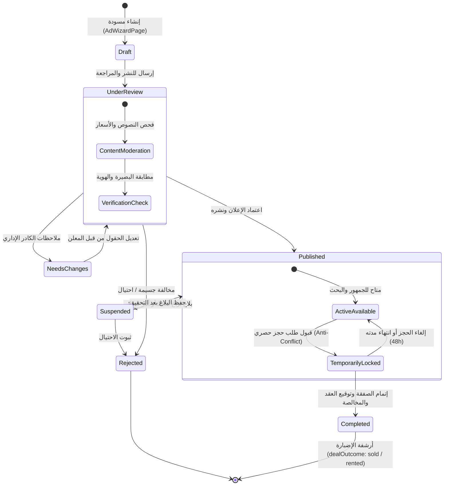
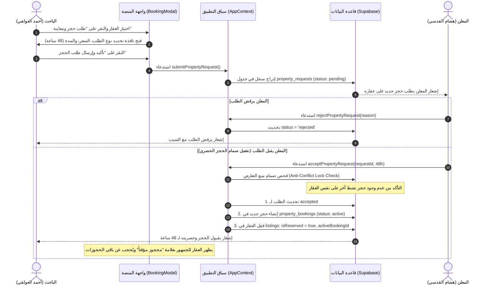
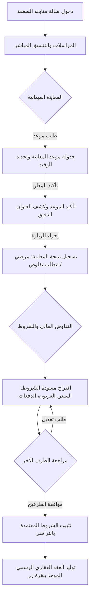
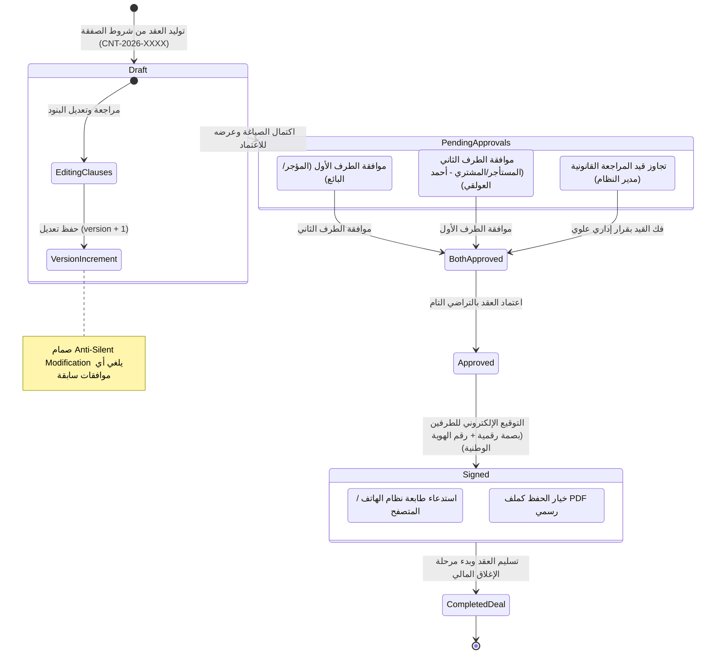
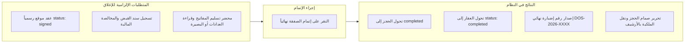
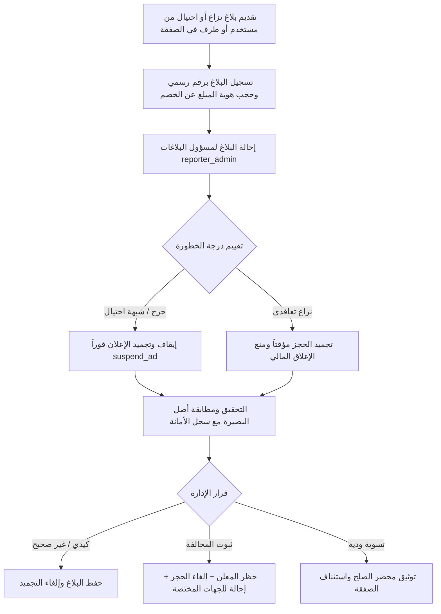

# 06. مسارات العمل ودورات الحياة التشغيلية (WORKFLOWS & LIFECYCLES)
## منصة «دلنّي» العقارية الوطنية الذكية (DALANI)

---

### 1. دورة حياة الإعلان العقاري (Listing Full Lifecycle)

توضح دورة الحياة التالية المسار الكامل للعقار منذ إنشائه كمسودة وحتى إتمام بيعه أو تأجيره ونقل ملكيته وأرشفته:

---

### 2. دورة حياة طلب العقار وصمام الحجز الحصري (Anti-Conflict Booking Workflow)

يوضح المخطط كيفية تقديم طلب الحجز وتفعيل قفل منع التعارض لمنع تكرار بيع العقار نفسه:

---

### 3. مسار صالة التفاوض والمعاينة الميدانية (Deal Workspace Workflow)

بعد إنشاء الحجز النشط، يدخل الطرفان في مساحة عمل تفاعلية (`BookingDealWorkspaceModal`):

---

### 4. دورة حياة العقد القانوني الموحد والاعتمادات والطباعة (Contract Lifecycle)

يوضح المخطط آلية صياغة العقد، منع التعديل الصامت، مسار الموافقات، والتوقيع الإلكتروني والطباعة:

---

### 5. دورة تسوية وإغلاق الصفقة والمخالصة النهائية (Deal Settlement & Handover)

المرحلة الختامية قبل أرشفة العقار نهائياً:

---

### 6. مسار إدارة النزاعات والبلاغات القانونية (Dispute & Incident Workflow)

